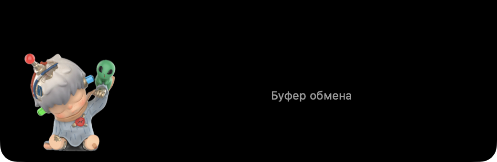

# Add a Hirono character to your MacBook notch
<i>only available on macOs 15 and higher</i>

### Quick start guide / запуск

Installation
1. Drag `NotchBuddy.app` into your **Applications** folder and open it (double-click).
2. macOS will warn you that it cannot verify the app. Click **Done**.
3. Go to **System Settings → Privacy & Security**, scroll down, click **Open Anyway**, and confirm.
4. On the first launch, macOS will ask for permission to access the clipboard. Select **Always Allow**.

Alternative
1. Drag `NotchBuddy.app` into your **Applications** folder and open it (double-click).
2. Open **Terminal** app and paste command:
```bash
xattr -cr /Applications/NotchBuddy.app
```

Features
- Hover over the notch to reveal a convenient menu containing all items copied during the current session.
- Copy any item by clicking on it or dragging and dropping it.
- Doublefinger-click the character to clear the history and/or quit the app.



### Stack / стэк приложения
```
NOTCH/
  Package.swift                     # targets: NotchBuddyCore (lib), NotchBuddy (exe), NotchBuddyCoreTests
  Sources/NotchBuddyCore/           # чистая логика, без AppKit-окон — покрыта тестами
    Clipboard/ClipboardItem.swift       # enum Kind { text, link(URL), image }, id, дата, contentHash
    Clipboard/ClipboardHistory.swift    # max 10, дедуп → наверх, clear()
    Clipboard/PasteboardSnapshot.swift  # абстракция над NSPasteboard (типы + данные) → классификация
    Character/Spring.swift              # пружина-демпфер для суставов (angle/offset)
    Character/Rig.swift                 # описание слоёв: имя, pivot, родитель, z-порядок (из rig.json)
    Character/BehaviorBrain.swift       # состояния: idle/attentive/tickled/reacting/sleeping; инъекция clock+random
    Notch/NotchGeometry.swift           # расчёт прямоугольника челки и «ушей» из safeArea/auxiliaryTop*Area
  Sources/NotchBuddy/               # AppKit/SwiftUI-клей
    App.swift                           # NSApplication, accessory policy
    NotchPanel.swift                    # NSPanel borderless/nonactivating, level .statusBar+1,
                                        # [.canJoinAllSpaces,.stationary,.fullScreenAuxiliary];
                                        # ignoresMouseEvents переключается по попаданию курсора в форму
    NotchView.swift                     # чёрная форма челки, свёрнуто/раскрыто (spring-анимация)
    CharacterView.swift                 # TimelineView + слои Image с rotationEffect(anchor:) + rotation3DEffect головы + ночной фильтр/свечение (.plusLighter)
    ClipboardListView.swift             # строки, клик → копия, .onDrag → NSItemProvider
    PasteboardWatcher.swift             # таймер 0.4 с по changeCount, игнор собственных записей
    InputMonitor.swift                  # курсор, глобальные клики, idle-время → BehaviorBrain
    Resources/Character/*.png, rig.json
  Tests/NotchBuddyCoreTests/        # Swift Testing
  tools/rig/                        # одноразовые скрипты нарезки (Python venv: Pillow + OpenCV inpaint)
  scripts/build-app.sh              # swift build -c release → build/NotchBuddy.app (Info.plist, codesign "Apple Development")
```

Поток данных: `InputMonitor` и `PasteboardWatcher` → события → `BehaviorBrain` (цели для суставов + одноразовые реакции) → `Spring`-интеграторы в `TimelineView` → `CharacterView`. `PasteboardWatcher` → `ClipboardHistory` → `ClipboardListView` / счётчик.